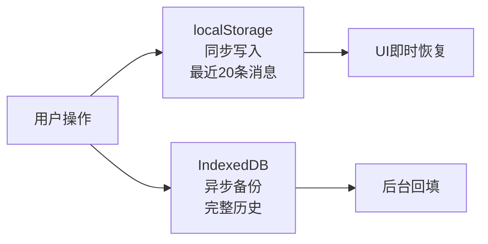

# AI Code Tutor — 项目上下文

## 项目一句话

AI 编程导师——用户粘贴代码让 AI 解释/审查/分析，也可以聊天式学习编程。前端 Vue 3 + 后端 Express，所有 AI 请求走自己的后端代理。

---

## 快速启动

```bash
npm run dev            # 并发启动前端(:5173) + 后端(:3001)
npm run dev:client     # 只启动前端
npm run dev:server     # 只启动后端
```

后端依赖 `.env` 文件（在 `server/` 下），需要配置 API Key。

---

## 技术栈

| 层 | 技术 | 说明 |
|---|---|---|
| 前端框架 | Vue 3 + Composition API + `<script setup>` | 所有 SFC 统一风格 |
| 构建 | Vite 5 | proxy /api → localhost:3001 |
| 状态管理 | Pinia（Setup Store 语法） | 7 个 store |
| CSS | Tailwind CSS 3 + `cn()` 工具函数 | dark 模式，CSS 变量主题 |
| 图标 | lucide-vue-next | 全站统一图标库 |
| 后端 | Express 4 + TypeScript | 编译为 JS 运行 |
| AI API | 原始 `https.request`（非 SDK） | 支持 DeepSeek / OpenAI 任意兼容接口 |
| 持久化 | localStorage（主）+ IndexedDB（备份） | 双轨架构 |

---

## 目录结构速览

```
├── client/src/
│   ├── views/              页面（路由入口）
│   ├── components/         可复用 UI
│   │   ├── chat/           聊天（ChatArea, ChatMessage, ChatInput, MarkdownRenderer）
│   │   ├── code/           代码（CodeExplainer, CodeViewer, SelectionTooltip）
│   │   ├── diff/           Diff 对比（7 个文件，分层组件树）
│   │   ├── markdown/       Markdown 扩展（CodeBlock, MermaidDiagram, KatexInline）
│   │   ├── layout/         布局（Sidebar, CommandPalette）
│   │   └── ui/             基础（BaseButton, BaseInput）
│   ├── composables/        Vue 逻辑复用（10 个文件，业务核心）
│   ├── stores/             Pinia 状态（chat, settings, diff, hover, ui, workspace）
│   ├── services/           纯 TS 服务层（不依赖 Vue）
│   │   ├── ai/             AI 客户端（4 个 API 函数, SSE 解析, 错误恢复）
│   │   ├── parser/         Diff 解析, JSON 校验
│   │   └── persistence/    localStorage + IndexedDB 双轨
│   ├── types/              TypeScript 类型（chat, diff, code, ai-response）
│   ├── workers/            Web Worker（markdown 离线程解析）
│   ├── lib/                工具函数（utils, lru-cache, language-detect, keywords）
│   └── router/             路由（/ → /explain → /diff → /settings）
│
├── server/src/
│   ├── index.ts            入口（Express + CORS + 路由注册）
│   ├── routes/             4 个 API 路由（chat, explanation, diff, analyze）
│   └── services/           AI 调用（ai.ts, safety.ts, types.ts）
```

### 数据流

```
用户操作 → views → components → composables → stores → services/ai/client.ts
  → fetch('/api/*') → Vite proxy(dev) → server/routes/* → server/services/ai.ts
  → https.request → DeepSeek/OpenAI API → SSE stream → 原路返回
```

---

## 4 个 API 端点

| 端点 | 前端函数 | 用途 | 请求体关键字段 |
|---|---|---|---|
| `POST /api/chat/stream` | `streamChat()` | 聊天对话 | `messages[]` |
| `POST /api/explanation/explain` | `streamExplanation()` | 代码解释 | `code`, `language` |
| `POST /api/diff/explain` | `streamDiffExplanation()` | Diff 对比解释 | `oldCode`, `newCode`, `hunks` |
| `POST /api/analyze` | `streamAnalyze()` | 多维代码分析 | `files[]`, `modes[]` |

所有请求都携带 `apiKey`、`model`、`replyLanguage` 三个覆盖字段：
- 用户填写 → 覆盖 `.env` 配置
- 用户留空 → 用 `.env` 默认值

---

## 关键架构决策

### 1. SSE 流式传输（自己写，不用 EventSource）

前后端都自己处理 SSE，原因：
- EventSource 只支持 GET 请求（聊天消息体可能很大）
- 需要自定义 headers（Authorization）
- 需要处理 DeepSeek 特有的 `reasoning_content` 字段

前端用 `ReadableStream.getReader()` + `async function*` 逐行解析。后端用原始 `https.request`（不用 OpenAI SDK），保持厂商无关。

**超时链**：外部 AbortSignal + 内部 120s 定时器通过 `addEventListener('abort')` 链接，任一触发即取消。

### 2. 持久化：localStorage（主）+ IndexedDB（备份）



- localStorage 存最近的 20 条消息（即时恢复 UI）
- IndexedDB 存完整历史（`fire-and-forget` 异步备份）
- 启动时先读 localStorage，后台用 IndexedDB 回填
- 接近 5MB 上限时：`ensureQuota()` 自动驱逐 unpinned 旧会话

### 3. Markdown 渲染：Web Worker + 主线程双通道

```
Worker: markdown-it 解析（不阻塞 UI）
  → 输出 <pre><code class="language-xxx">（HTML 转义代码）
主线程: 正则提取代码块 → Shiki 高亮 → 替换回 HTML
```

三阶降级：Worker → 主线程内置 Shiki → 保持前次内容。

### 4. 语言覆盖层（Language Override）

用户在设置页选择 zh/en/auto → 后端在 System Prompt 顶部注入覆盖性指令：

```
auto → 不注入，使用 Prompt 原规则
zh   → 注入 "始终用中文回复"
en   → 注入 "Always reply in English"
```

---

## 安全防护（三层）

1. **System Prompt 指令** — 告诉 AI 什么能做什么不能做
2. **输入正则拦截** — 16 个模式覆盖色情/恶意软件/越狱（含 DAN）/冒充
3. **输出扫描** — 流结束后扫描敏感关键词，记录日志

---

## 常用的模式/约定

- **AsyncGenerator**：所有 AI API 函数返回 `AsyncGenerator<StreamChunk>`，用 `for await...of` 消费
- **AbortController**：每个可取消操作都有一个 controller，外部 signal 通过 `addEventListener` 链入
- **CSS 命名**：Tailwind utility 优先，dark 模式用 CSS 变量（`--background`、`--foreground` 等）
- **响应式**：`ref()` 是默认选择，`computed()` 用于派生状态，`watch()` 用于副作用

---

## 使用服务时要注意的

1. **API Key 配置**：后端 `.env` 必须有 Key 才能启动，用户也可以在设置页填入自己的 Key
2. **Vite proxy**：开发时 `/api` 请求转到 `localhost:3001`，生产构建需要独立部署后端
3. **SSE 流超时**：120s（聊天）/ 180s（分析），超过会自动取消
4. **模型**：默认 `deepseek-v4-flash`，用户在设置页可以自由切换任何兼容模型

---

## 还没做/设计文档有但没实现的功能

- **流程图可视化**（DESIGN.md 规划了 VueFlow + dagre，但组件没写）
- **虚拟滚动**（长消息列表全量渲染，没有做 `vue-virtual-scroller`）
- **消息分支树 UI**（store 里存了 `childrenIds` 但 UI 没做分支切换）
- **IndexedDB 只写不读**（用作备份，页面恢复还是靠 localStorage）
